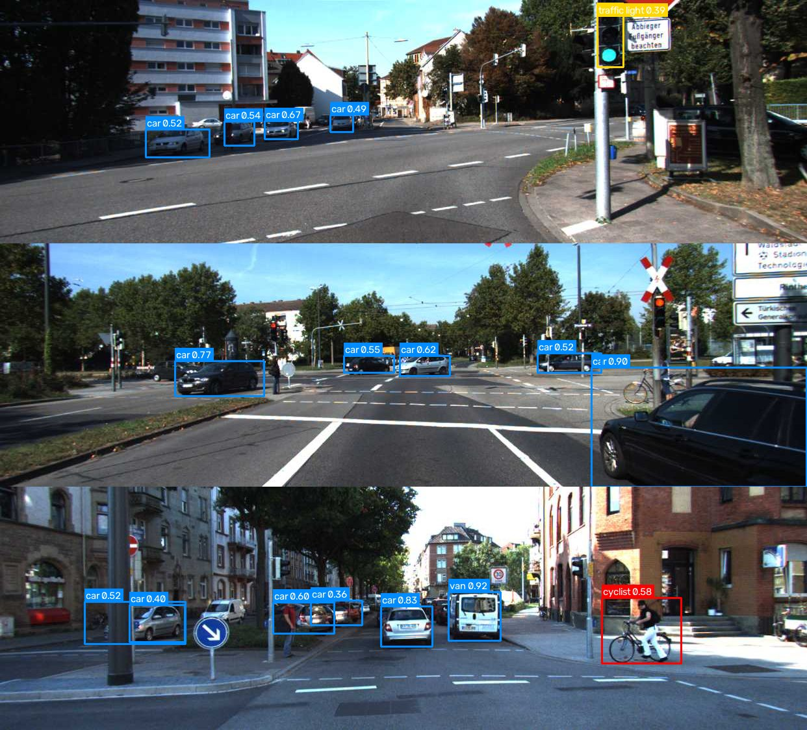
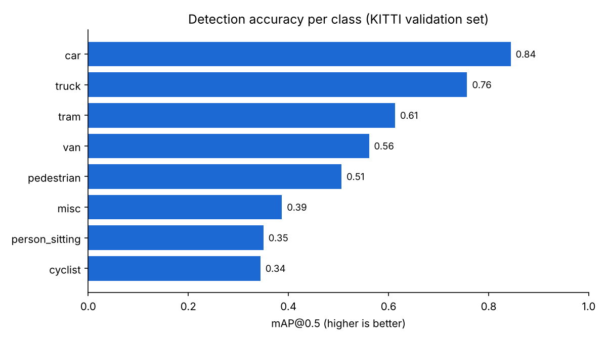
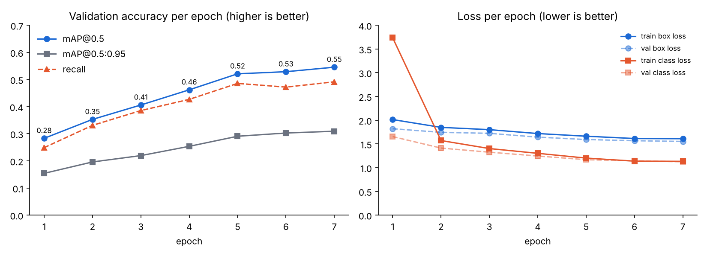
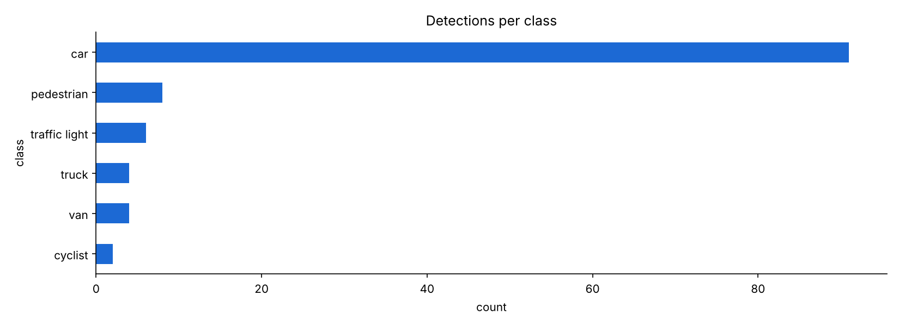

# Automotive Object Detection (YOLO26 on KITTI)

I fine-tuned a YOLO26 nano model on KITTI to detect cars, vans, trucks, trams, pedestrians and cyclists in street scenes. A second, pretrained model adds traffic lights and stop signs. Every detection is also written to a CSV file, so you can open the results in Excel or Power BI instead of just looking at pictures.

KITTI is real driving footage recorded around Karlsruhe, which made it a good fit for what I'm interested in: perception for driver assistance (emergency braking, pedestrian warnings and so on).


<sub>Validation images the model never saw during training. Blue: vehicles, red: pedestrians and cyclists, yellow: traffic lights.</sub>

## Results

Evaluated on the 1,496 KITTI validation images (8,128 labelled objects).

| Metric | After epoch 1 | Final model |
|---|---|---|
| mAP@0.5 | 0.283 | **0.545** |
| mAP@0.5:0.95 | 0.154 | **0.309** |
| Precision | 0.510 | **0.656** |
| Recall | 0.249 | **0.491** |
| Inference time | – | **17.7 ms per image** on a 2-core CPU, no GPU |

| Class | Precision | Recall | mAP@0.5 | mAP@0.5:0.95 |
|---|---|---|---|---|
| car | 0.784 | 0.775 | 0.844 | 0.556 |
| truck | 0.866 | 0.639 | 0.757 | 0.505 |
| tram | 0.629 | 0.573 | 0.613 | 0.306 |
| van | 0.624 | 0.512 | 0.561 | 0.353 |
| pedestrian | 0.622 | 0.479 | 0.506 | 0.209 |
| person_sitting | 0.476 | 0.333 | 0.350 | 0.154 |
| cyclist | 0.534 | 0.318 | 0.344 | 0.160 |

<sub>YOLO26-nano, 7 epochs at 416 px, trained on CPU only. All metrics are in [`results/`](results/).</sub>





### What I noticed

Cars work well (mAP@0.5 of 0.84), which isn't surprising since they make up about 70% of the labelled objects in KITTI. Basically, the more examples a class had, the better it did.

Pedestrians and cyclists are the weak point, with a recall of 0.48 and 0.32. They're small in the image and less common in the data. I also had to train at 416 px to keep it manageable on a CPU, which hurts small objects the most. For a safety system this is the part I'd fix first, because missing a pedestrian is much worse than a false alarm.

Speed was fine even without a GPU: 17.7 ms per image on two CPU cores, so roughly 55 frames per second for the model alone.

The scores were still going up when I stopped training (mAP@0.5 went from 0.28 to 0.55 over 7 epochs). Training longer on a GPU at 640 px should help everything, especially small objects.

### Detections as data

`detect.py` saves every detection to a CSV (source, frame, class, confidence, box) and `summarize_detections.py` turns that into a small traffic report. On 40 validation scenes it counted 91 cars, 8 pedestrians, 6 traffic lights, 4 trucks, 4 vans and 2 cyclists, with an average confidence of 0.66.



## How it works

```
 camera frame ──► YOLO26 fine-tuned on KITTI ──► cars, vans, trucks, trams,
       │                                          pedestrians, cyclists
       └────────► YOLO26 pretrained on COCO ───► traffic lights, stop signs
                                                        │
                       annotated image / video  ◄───────┤
                       detections.csv (class, confidence, box, frame) ◄┘
```

I picked the nano version of YOLO26 (released January 2026) because it's small and runs end-to-end without NMS, which is closer to what you could actually run on hardware in a car. I started from COCO-pretrained weights rather than training from scratch, so the model was useful after a few epochs even with limited compute.

KITTI has no labels for traffic lights or signs, so instead of labelling data myself I run a second, COCO-pretrained model for those classes.

## Project structure

```
automotive-object-detection/
├── configs/kitti.yaml              # dataset definition (downloads KITTI automatically, ~390 MB)
├── src/
│   ├── train.py                    # fine-tune YOLO26 on KITTI
│   ├── evaluate.py                 # per-class precision / recall / mAP -> CSV, chart, markdown
│   ├── detect.py                   # image, folder, video or webcam -> annotated output + CSV
│   └── summarize_detections.py     # traffic report from detections.csv
├── notebooks/train_on_colab.ipynb  # retrain on a free Google Colab GPU
├── weights/best.pt                 # trained model (5.4 MB)
├── results/                        # metrics, training log, sample detections
└── assets/                         # images used in this README
```

## Running it

```bash
pip install -r requirements.txt

python src/detect.py --source path/to/dashcam.mp4    # run the trained model
python src/summarize_detections.py                    # traffic report for that run
python src/evaluate.py                                # reproduce the metrics above
python src/train.py --epochs 50 --device 0            # retrain (a GPU helps a lot)
```

You can also open `notebooks/train_on_colab.ipynb` in Google Colab and retrain on a free GPU.

## Limitations and what I'd do next

- Pedestrian and cyclist recall is too low. Longer training at 640 px and more examples of these classes are the obvious fix.
- Signs: the COCO model only knows stop signs. Fine-tuning on the German Traffic Sign Detection Benchmark (GTSDB) would add speed limits, give-way signs and so on.
- Tracking: ByteTrack (built into Ultralytics) would let me follow each vehicle across frames and count unique road users.
- Deployment: export to ONNX or TensorRT and measure latency on embedded hardware.
- KITTI is daytime and good weather only. Night, rain and snow would need extra data, for example BDD100K.

## Tech stack

Python, Ultralytics YOLO26, PyTorch, OpenCV, pandas, matplotlib, Google Colab

## Credits and licences

- Model and training framework: [Ultralytics](https://github.com/ultralytics/ultralytics) (AGPL-3.0)
- Dataset and demo images: [KITTI Vision Benchmark](https://www.cvlibs.net/datasets/kitti/), Karlsruhe Institute of Technology and Toyota Technological Institute at Chicago (CC BY-NC-SA 3.0, non-commercial use)
- Project idea from [project-based-learning](https://github.com/practical-tutorials/project-based-learning)

Released under AGPL-3.0 to match Ultralytics.

Souad Essemyhij, MSc Robotics and Autonomous Systems, Universität zu Lübeck. [LinkedIn](https://www.linkedin.com/in/souad-essemyhi-742a9520b/)
